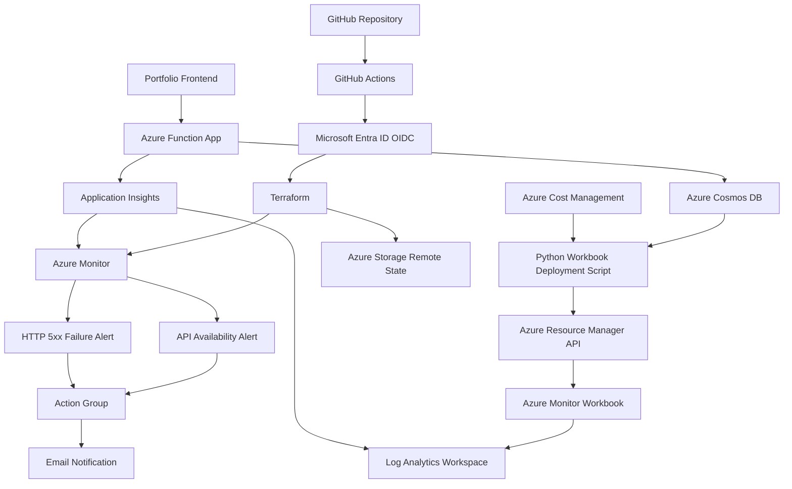

# Azure Cloud Operations & Observability Platform

An Azure-based cloud operations and observability project designed to monitor the health, availability, performance and failures of a serverless API.

The platform uses Azure Monitor, Application Insights, Log Analytics, KQL, Terraform and GitHub Actions to demonstrate infrastructure as code, automated deployment, proactive monitoring and operational troubleshooting.

## Project Objectives

- Monitor API health and availability.
- Detect HTTP 5xx server errors.
- Configure automated alert notifications.
- Investigate application performance and failures.
- Monitor API availability using synthetic web tests.
- Build operational dashboards using Azure Monitor Workbooks.
- Track portfolio visitor, resume and certificate engagement analytics.
- Integrate Azure Cost Management data for cost visibility.
- Manage monitoring infrastructure through Terraform.
- Automate Terraform validation and deployment using GitHub Actions.
- Authenticate GitHub Actions securely using Microsoft Entra ID OIDC.

## Architecture



## Technology Stack

| Category | Technology |
|---|---|
| Cloud Platform | Microsoft Azure |
| Application | Azure Functions |
| Application Monitoring | Azure Application Insights |
| Log Analytics | Azure Log Analytics |
| Query Language | Kusto Query Language (KQL) |
| Alerting | Azure Monitor |
| Dashboard | Azure Monitor Workbook |
| Infrastructure as Code | Terraform |
| CI/CD | GitHub Actions |
| Authentication | Microsoft Entra ID OIDC |
| State Management | Azure Storage |

## Azure Resources

Resource group: `rg-portfolio`  
Region: `Central India`

| Resource | Name | Purpose |
|---|---|---|
| Application Insights | `aniket-portfolio-api` | Application telemetry |
| Action Group | `ag-portfolio-failures` | Email notifications |
| Scheduled Query Alert | `alert-portfolio-api-failures` | Detect HTTP 5xx errors |
| Availability Web Test | `portfolio-api-health-check-aniket-portfolio-api` | Synthetic API health monitoring |
| Availability Metric Alert | `portfolio-api-health-check-aniket-portfolio-api` | Detect availability failures |
| Monitor Workbook | Existing Azure Monitor Workbook | Monitoring dashboard |

Application Insights retention is configured for 90 days.

The Azure Monitor Workbook is deployed using `scripts/deploy_workbook.py` through the Azure Resource Manager API. It is maintained separately from the five Terraform-managed monitoring resources.

## Monitoring Configuration

### 1. API Failure Monitoring

The scheduled query alert detects HTTP 500–599 responses.

KQL query:

```kusto
requests
| where toint(resultCode) >= 500
| where timestamp > ago(5m)
```

Configuration:

- Severity: 2 - Warning
- Evaluation frequency: 5 minutes
- Evaluation window: 5 minutes
- Threshold: Greater than 0 failures
- Action: Send notification through the configured Action Group

### 2. API Availability Monitoring

A standard availability web test periodically sends an HTTP GET request to:

`https://aniket-portfolio-api.azurewebsites.net/api/health`

Expected response: HTTP 200.

Configuration:

- Test frequency: 15 minutes
- Test location: Singapore
- Retry enabled
- Timeout: 120 seconds
- SSL validation enabled
- Expected HTTP status: 200

The associated availability metric alert uses:

- Severity: 1 - Critical
- Evaluation frequency: 1 minute
- Evaluation window: 5 minutes
- Failed location threshold: 1

### 3. Application Performance and Failure Investigation

Application Insights collects request telemetry and supports investigation of:

- Failed requests
- Request duration
- Dependencies
- Exceptions
- API performance
- Availability results

KQL is used to investigate application behaviour.

## Terraform Infrastructure as Code

Terraform manages five existing Azure monitoring resources.

The configuration is maintained in the `terraform/` directory.

### Remote State

Terraform state is stored remotely in Azure Storage.

| Setting | Value |
|---|---|
| Resource Group | `rg-portfolio` |
| Storage Account | `aniketportfolio07` |
| Container | `terraform-state` |
| State Key | `project2.tfstate` |
| Authentication | Azure AD |
| CI Authentication | OIDC |

Terraform state files are not committed to GitHub.

### Local Terraform Commands

Initialize:

```bash
cd terraform
terraform init
```

Format:

```bash
terraform fmt -check -recursive
```

Validate:

```bash
terraform validate
```

Review infrastructure changes:

```bash
terraform plan
```

Deployment must be performed through the approved deployment workflow or another explicitly authorized process.

Do not run `terraform apply` without reviewing and approving the proposed changes.

## GitHub Actions CI/CD

Two GitHub Actions workflows are configured.

### Terraform CI

File: `.github/workflows/terraform.yml`

Triggered by:
- Push to `main`
- Manual workflow dispatch

Pipeline steps:
1. Checkout repository.
2. Set up Terraform.
3. Authenticate to Azure using OIDC.
4. Check Terraform formatting.
5. Initialize Terraform.
6. Validate configuration.
7. Generate Terraform plan.

The CI identity has read-only access to Azure resources, along with the permissions needed to access remote Terraform state.

### Terraform Deployment

File: `.github/workflows/terraform-apply.yml`

Triggered manually through GitHub Actions.

Pipeline steps:
1. Checkout repository.
2. Set up Terraform.
3. Authenticate using a separate deployment identity.
4. Initialize Terraform.
5. Check formatting.
6. Validate configuration.
7. Generate a Terraform plan.
8. Apply the saved plan.
9. Remove temporary plan files.

The workflow uses the protected GitHub Environment `terraform-apply`, which requires manual reviewer approval before deployment.

The deployment identity has separate permissions from the CI identity.

### Authentication and Security

GitHub Actions authenticates to Azure using Microsoft Entra ID OpenID Connect (OIDC).

No Azure client secrets are stored in the repository.

Security practices:
- No credentials or private keys in Git.
- No `.env` files committed.
- No Terraform state files committed.
- No Terraform plan artifacts committed.
- Separate CI and deployment identities.
- Manual approval before infrastructure deployment.
- Remote Terraform state stored in Azure Storage.

## Operational Testing

The following tests have been performed:

| Test | Result |
|---|---|
| API health endpoint | Successful |
| Intentional HTTP 500 failure | Successful |
| Application Insights failure detection | Verified |
| Azure Monitor alert firing | Verified |
| Action Group email notification | Verified |
| Temporary failure endpoint removal | Completed |
| Visitor counter after test | Verified |
| Terraform CI workflow | Successful |
| Terraform deployment workflow | Successful |
| Manual deployment approval | Verified |
| Terraform apply | 0 added, 0 changed, 0 destroyed |

Note: Azure Monitor Action Group test notifications are not supported on the current Azure Free Trial subscription. Actual alert firing and email notification were verified using the controlled HTTP 500 test.

## Repository Structure

```text
azure-cloud-operations-observability/
│
├── .github/
│   └── workflows/
│       ├── terraform.yml
│       └── terraform-apply.yml
│
├── docs/
│   ├── screenshots/
│   ├── workbook/
│   │   └── queries/
│   └── runbooks/
│
├── terraform/
│   ├── backend.tf
│   ├── main.tf
│   ├── outputs.tf
│   ├── providers.tf
│   └── variables.tf
│
├── scripts/
│   └── deploy_workbook.py
├── work_items/
├── config.py
├── main.py
├── requirements.txt
├── .env.example
├── .gitignore
└── README.md
```

## Documentation and Evidence

Monitoring and operational evidence is maintained in `docs/screenshots/`.

The Azure Monitor Workbook definition and KQL queries are maintained in `docs/workbook/`.

Workbook deployment is handled by `scripts/deploy_workbook.py`.

Operational procedures are documented in `docs/runbooks/`, including API availability, API failure investigation and Application Insights troubleshooting.

## Project Status

**Status: In Progress**

Completed:
- Azure monitoring infrastructure and Application Insights integration.
- Log Analytics investigation using KQL.
- HTTP 5xx failure alerting and API availability monitoring.
- Azure Monitor Workbook with 10 dashboard components.
- Portfolio visitor, resume and certificate analytics in the workbook.
- Azure Cost Management integration for cost visibility.
- Python-based Azure Workbook deployment and verification.
- Terraform infrastructure management and remote state.
- GitHub Actions Terraform CI and deployment workflows.
- Microsoft Entra ID OIDC authentication.
- Separate CI and deployment identities.
- Protected deployment approval.
- Controlled failure testing and alert notification verification.
- Three operational runbooks and monitoring evidence screenshots.

Remaining:
- Final repository, documentation and security review.
- Review cost governance options; Azure budget thresholds and budget alerts are not currently configured.

## Cost Management

The project uses the existing Azure Free Trial subscription and available credits.

Cost visibility is integrated into the Azure Monitor Workbook using Azure Cost Management data.

Cost-conscious practices:
- Reuse existing Azure resources.
- Avoid unnecessary infrastructure duplication.
- Keep monitoring configuration appropriate for the project.
- Review Azure Cost Management regularly.
- Avoid upgrading the subscription solely for testing.

Current limitation: Cost data is visible in the workbook, but budget thresholds and budget alerts have not been configured. Cost visibility should not be interpreted as automated budget enforcement or notification.

## Author

Aniket Pawar

GitHub: https://github.com/712Aniket

Portfolio: https://aniketpawar.is-a.dev
