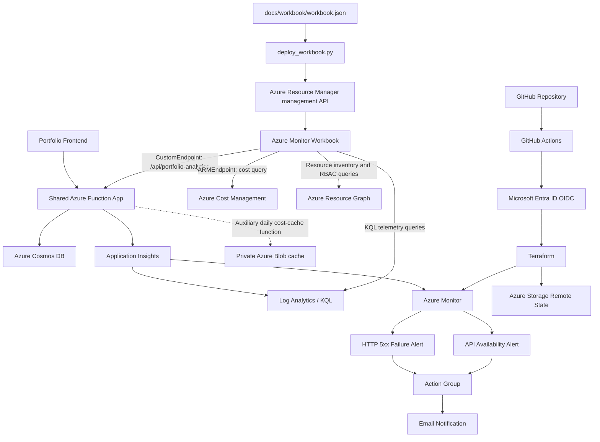

<!-- PROJECT2-PRIMARY-WORKBOOK -->
## Primary Azure Workbook

The primary workbook is **Azure Cloud Operations & Observability Platform** (`43a2aae2-21ba-417a-9a09-409792adcd64`). The retired workbook `28236c19-2756-48f5-8e4e-a176a4a8210d` is kept untouched for rollback. The canonical deployment source is `docs/workbook/workbook.json`. Run `python scripts/deploy_workbook.py` for preflight; add `--deploy` to update the primary workbook.

# Azure Cloud Operations & Observability Platform

An Azure-based cloud operations and observability project designed to monitor the health, availability, performance and failures of a serverless API.

The platform uses Azure Monitor, Application Insights, Log Analytics, KQL, Terraform and GitHub Actions to demonstrate infrastructure as code, automated deployment, proactive monitoring and operational troubleshooting.

## Project Objectives

- Monitor API health and availability.
- Detect HTTP 5xx server errors.
- Configure automated alert notifications.
- Investigate application performance and failures.
- Monitor API availability using synthetic web tests.
- Build operational dashboards using Azure Monitor Workbooks.
- Track portfolio visitor, resume and certificate engagement analytics.
- Integrate Azure Cost Management data for cost visibility.
- Manage monitoring infrastructure through Terraform.
- Automate Terraform validation and deployment using GitHub Actions.
- Authenticate GitHub Actions securely using Microsoft Entra ID OIDC.

## Azure Boards – Project Planning and Work Tracking

Azure DevOps Boards is used to plan and track Project 2 delivery. The backlog is structured hierarchically as **Epics → Features → User Stories → Tasks**.

The repository includes backlog-management helpers under `work_items/`:

- `work_items/epics.py` checks existing Epic titles and creates missing planned Epics.
- `work_items/backlog.py` uses WIQL and parent-child relationships to check existing work items, then creates missing Features, User Stories and Tasks without intentionally duplicating matching items (it checks the type, parent and title before creating).
- The checked-in backlog template defines **9 planned Epics**, **12 Feature/User Story groups**, and **24 implementation Tasks**.
- `config.py` reads `AZDO_ORG`, `AZDO_PROJECT` and `AZDO_PAT` from the local environment. Keep the Personal Access Token in an untracked `.env` file; never commit it or print it in logs.

These scripts seed and maintain the backlog; Azure Boards remains the project work-tracking surface and source of current work-item status. They are separate from the Terraform infrastructure deployment workflows. The live board's organization/project URL is intentionally not hard-coded in this public README because it is supplied through local environment configuration.

## Architecture



## Technology Stack

| Category | Technology |
|---|---|
| Cloud Platform | Microsoft Azure |
| Application | Azure Functions |
| Application Monitoring | Azure Application Insights |
| Log Analytics | Azure Log Analytics |
| Query Language | Kusto Query Language (KQL) |
| Alerting | Azure Monitor |
| Dashboard | Azure Monitor Workbook |
| Infrastructure as Code | Terraform |
| CI/CD | GitHub Actions |
| Authentication | Microsoft Entra ID OIDC |
| State Management | Azure Storage |

## Azure Resources

Resource group: `rg-portfolio`  
Region: `Central India`

| Resource | Name | Purpose |
|---|---|---|
| Application Insights | `aniket-portfolio-api` | Application telemetry |
| Action Group | `ag-portfolio-failures` | Email notifications |
| Scheduled Query Alert | `alert-portfolio-api-failures` | Detect HTTP 5xx errors |
| Availability Web Test | `portfolio-api-health-check-aniket-portfolio-api` | Synthetic API health monitoring |
| Availability Metric Alert | `portfolio-api-health-check-aniket-portfolio-api` | Detect availability failures |
| Monitor Workbook | Existing Azure Monitor Workbook | Monitoring dashboard |

Application Insights retention is configured for 90 days.

The current workbook layout was saved in Azure Portal and exported to `docs/workbook/workbook.json`, which is the canonical serialized definition. `scripts/deploy_workbook.py` performs a preflight against the current 24-component layout and supports an explicit `--deploy` option for an Azure Resource Manager management-plane update. The workbook is maintained separately from the five Terraform-managed monitoring resources.

## Monitoring Configuration

### 1. API Failure Monitoring

The scheduled query alert detects HTTP 500–599 responses.

KQL query:

```kusto
requests
| where toint(resultCode) >= 500
| where timestamp > ago(5m)
```

Configuration:

- Severity: 2 - Warning
- Evaluation frequency: 5 minutes
- Evaluation window: 5 minutes
- Threshold: Greater than 0 failures
- Action: Send notification through the configured Action Group

### 2. API Availability Monitoring

A standard availability web test periodically sends an HTTP GET request to:

`https://aniket-portfolio-api.azurewebsites.net/api/health`

Expected response: HTTP 200.

Configuration:

- Test frequency: 15 minutes
- Test location: Singapore
- Retry enabled
- Timeout: 120 seconds
- SSL validation enabled
- Expected HTTP status: 200

The associated availability metric alert uses:

- Severity: 1 - Critical
- Evaluation frequency: 1 minute
- Evaluation window: 5 minutes
- Failed location threshold: 1

### 3. Application Performance and Failure Investigation

Application Insights collects request telemetry and supports investigation of:

- Failed requests
- Request duration
- Dependencies
- Exceptions
- API performance
- Availability results

KQL is used to investigate application behaviour.

### 4. Workbook Data Sources

The 24-component workbook combines several data sources rather than relying on a single query backend:

- **Application Insights / KQL:** request volume, HTTP status codes, failures, availability results, exceptions and API performance.
- **Project 1 portfolio analytics endpoint:** the workbook's custom-endpoint panels call `GET /api/portfolio-analytics`, which returns aggregated visitor geography, resume/certificate event totals, and appreciation/engagement metrics from Cosmos DB.
- **Azure Cost Management:** the cost panels use the Workbook's ARM endpoint to query the Cost Management Query API directly, grouping actual cost by date and resource. They do not call the Function App's `/api/cost-analytics` endpoint.
- **Azure Resource Graph:** the inventory, security configuration and RBAC panels query Azure resource and authorization metadata.

The Python deployment script publishes the workbook definition; it does not fetch Cost Management or Cosmos DB analytics data for the workbook.

## Shared Project 1 Function App Extension

Project 2 adds supporting endpoints to the existing Project 1 Function App. The latest extension source is maintained in the Project 1 repository's `resume-develop` branch:

- `GET /api/portfolio-analytics` — anonymous, read-only, aggregated portfolio analytics endpoint used by the workbook's visitor, certificate and appreciation panels.
- `GET /api/cost-analytics` — Function-key protected endpoint that reads the daily cost snapshot from a private Blob cache.
- `POST /api/cost-cache-refresh` — Function-key protected on-demand refresh operation.
- `daily_cost_cache_refresh` — timer-triggered daily refresh (02:30 UTC).

The cost cache uses the Function App's system-assigned managed identity for Blob Storage and Azure Cost Management access. **The workbook does not depend on the cost-cache HTTP endpoints**: its cost panels query Azure Cost Management through the Workbook ARM endpoint directly. The auxiliary cache endpoints are retained as protected supporting API functionality.

Source: [Project 1 API extension on `resume-develop`](https://github.com/712Aniket/azure-cloud-resume-challenge/tree/resume-develop/api).

## Terraform Infrastructure as Code

Terraform manages five existing Azure monitoring resources.

The configuration is maintained in the `terraform/` directory.

### Remote State

Terraform state is stored remotely in Azure Storage.

| Setting | Value |
|---|---|
| Resource Group | `rg-portfolio` |
| Storage Account | `aniketterraformstate26` |
| Container | `project2-tfstate` |
| State Key | `project2.tfstate` |
| Authentication | Microsoft Entra ID / Azure AD |
| CI Authentication | GitHub Actions OIDC |
| Apply Authentication | Separate GitHub OIDC deployment identity |
| State access | Blob Data Contributor scoped to the Project 2 container |

The state migration moved `project2.tfstate` from `aniketportfolio07/terraform-state` to `aniketterraformstate26/project2-tfstate`. The source state was backed up before migration; the destination state retained the original lineage and resource set, with the expected serial increment. The old Project 2 state blob was deleted only after the destination was checked, and the local backup was retained.

The dedicated state storage account also has a separate private `project1-tfstate` container for Project 1. Public blob access and shared-key authentication are disabled on the dedicated account; Terraform state files are not committed to GitHub.

### Local Terraform Commands

Initialize:

```bash
cd terraform
terraform init
```

Format:

```bash
terraform fmt -check -recursive
```

Validate:

```bash
terraform validate
```

Review infrastructure changes:

```bash
terraform plan
```

Deployment must be performed through the approved deployment workflow or another explicitly authorized process.

Do not run `terraform apply` without reviewing and approving the proposed changes.

## GitHub Actions CI/CD

Two GitHub Actions workflows are configured.

### Terraform CI

File: `.github/workflows/terraform.yml`

Triggered by:
- Push to `main`
- Manual workflow dispatch

Pipeline steps:
1. Checkout repository.
2. Set up Terraform.
3. Authenticate to Azure using OIDC.
4. Check Terraform formatting.
5. Initialize Terraform.
6. Validate configuration.
7. Generate Terraform plan.

The CI identity has read-only access to Azure resources, along with the permissions needed to access remote Terraform state.

### Terraform Deployment

File: `.github/workflows/terraform-apply.yml`

Triggered manually through GitHub Actions.

Pipeline steps:
1. Checkout repository.
2. Set up Terraform.
3. Authenticate using a separate deployment identity.
4. Initialize Terraform.
5. Check formatting.
6. Validate configuration.
7. Generate a Terraform plan.
8. Apply the saved plan.
9. Remove temporary plan files.

The workflow uses the protected GitHub Environment `terraform-apply`, which requires manual reviewer approval before deployment.

The deployment identity has separate permissions from the CI identity.

### Authentication and Security

GitHub Actions authenticates to Azure using Microsoft Entra ID OpenID Connect (OIDC).

No Azure client secrets are stored in the repository.

Security practices:
- No credentials or private keys in Git.
- No `.env` files committed.
- No Terraform state files committed.
- No Terraform plan artifacts committed.
- Separate CI and deployment identities.
- Manual approval before infrastructure deployment.
- Remote Terraform state stored in Azure Storage.

## Operational Testing

The following tests have been performed:

| Test | Result |
|---|---|
| API health endpoint | Successful |
| Intentional HTTP 500 failure | Successful |
| Application Insights failure detection | Verified |
| Azure Monitor alert firing | Verified |
| Action Group email notification | Verified |
| Temporary failure endpoint removal | Completed |
| Visitor counter after test | Verified |
| Terraform CI before state migration | Successful |
| Terraform Apply before state migration | Successful; manual approval verified |
| Terraform Apply before state migration | 0 added, 0 changed, 0 destroyed |
| Terraform CI after state migration | Successful on commit `5ac1ed1356de77db87e28be51a5e397243a3c61b` (run [45362003217](https://github.com/712Aniket/azure-cloud-operations-observability/actions/runs/45362003217)) |
| Terraform plan after state migration | No changes; state lock acquired and released |
| Separate Apply OIDC identity after state migration | **Pending independent verification** |

Additional security and regression verification:

| Test | Result |
|---|---|
| Function App HTTPS-only setting | Enabled |
| HTTP health request redirects to HTTPS | HTTP 301 verified |
| Anonymous cost analytics request | HTTP 401 verified |
| Anonymous cost cache refresh request | HTTP 401 verified |
| Cosmos DB local/key authentication | Disabled |
| Cosmos DB firewall rules | 32 rules, including the Azure datacenter exception |
| Health endpoint after security changes | HTTP 200 |
| Visitor counter after security changes | HTTP 200 |
| Portfolio analytics after security changes | HTTP 200 |

The cost analytics and cost-cache-refresh HTTP endpoints require a Function key. The Azure Monitor Workbook's cost panels query Azure Cost Management through Azure Resource Manager directly; they do not depend on the Function App's `/api/cost-analytics` endpoint.

Note: Azure Monitor Action Group test notifications are not supported on the current Azure Free Trial subscription. Actual alert firing and email notification were verified using the controlled HTTP 500 test.

## Repository Structure

```text
azure-cloud-operations-observability/
│
├── .github/
│   └── workflows/
│       ├── terraform.yml
│       └── terraform-apply.yml
│
├── docs/
│   ├── screenshots/
│   ├── workbook/
│   │   └── queries/
│   └── runbooks/
│
├── terraform/
│   ├── backend.tf
│   ├── main.tf
│   ├── outputs.tf
│   ├── providers.tf
│   └── variables.tf
│
├── scripts/
│   └── deploy_workbook.py
├── work_items/
├── config.py
├── main.py
├── requirements.txt
├── .env.example
├── .gitignore
└── README.md
```

## Documentation and Evidence

Monitoring and operational evidence is maintained in `docs/screenshots/`. The repository contains 20 sanitized evidence screenshots.

The Azure Monitor Workbook definition and KQL queries are maintained in `docs/workbook/`. The current primary workbook contains 24 components.

Workbook deployment is handled by `scripts/deploy_workbook.py`.

Operational procedures are documented in `docs/runbooks/`, including API availability, API failure investigation and Application Insights troubleshooting. Three operational runbooks are maintained in the repository.

## Project Status

**Status: Completed — agreed core scope**

The agreed core objectives for the Azure Cloud Operations & Observability Platform have been implemented and verified.

Completed:
- Azure monitoring infrastructure and Application Insights integration.
- Log Analytics investigation using KQL.
- HTTP 5xx failure alerting and API availability monitoring.
- Application performance, dependency and exception investigation.
- Azure Monitor Workbook with 24 components, synchronized to `docs/workbook/workbook.json`.
- Portfolio visitor, resume and certificate analytics in the workbook.
- Portfolio engagement and appreciation analytics.
- Azure Cost Management integration for cost visibility.
- Python-based Azure Workbook deployment and verification.
- Terraform infrastructure management and Azure Storage remote state.
- GitHub Actions Terraform CI and deployment workflows.
- Microsoft Entra ID OIDC authentication, separate CI/deployment identities and protected deployment approval.
- Controlled failure testing and alert notification verification.
- Three operational runbooks and 20 sanitized evidence screenshots.
- Security hardening and final API regression tests: HTTPS-only enabled, cost endpoints protected by Function keys, Cosmos DB local authentication disabled, and Cosmos DB network rules configured.

### Deferred items and known limitations

- **Azure budget:** A `₹300/month` budget named `portfolio-monthly-budget` is configured at the `rg-portfolio` scope for 1 November 2026 through 31 October 2027. It sends notifications at 50%, 80% and 100% actual spend, plus 100% forecasted spend, through `ag-portfolio-failures`. Because the budget is resource-group scoped, it covers Project 1 and Project 2 resources together; it is not a Project 2-only limit. Budget notifications do not stop or throttle resource spending.
- **Function runtime storage permissions:** Terraform state has been moved out of `aniketportfolio07` into the dedicated `aniketterraformstate26` account, with separate private containers for Project 1 and Project 2. The Function App still uses `aniketportfolio07` for host/runtime storage and its auxiliary cost cache, and its managed identity retains account-scope `Storage Blob Data Owner` on that old application-storage account. That permission is broader than a cache-only role, but the old account no longer contains the Project 1 or Project 2 Terraform state. Continue to review whether the Function identity can be narrowed without disrupting the Functions host.
- **Cosmos DB network exception:** The Cosmos DB firewall retains 31 selected IP entries and includes the `0.0.0.0` Azure-datacenter exception (32 rules total) to keep the Flex Consumption Function App reachable despite its changing outbound IPs. This is broader than an allowlist for only this Function App; it allows network connection attempts from Azure datacenters generally. Cosmos DB local/key authentication is disabled, so a caller still needs valid Microsoft Entra ID authorization.
- **FTPS deployment access:** The Function App's current FTP state is `FtpsOnly`. This blocks unencrypted FTP but does not disable FTP-based deployment access altogether. Review and disable it when no longer needed, after confirming no deployment process depends on it.
- **Decommissioning:** Project 1 and Project 2 share resources in `rg-portfolio`. Do not delete the entire resource group to remove Project 2; identify and remove Project 2-only resources individually, preserving the live portfolio API, visitor counter and their dependencies.

These limitations are documented rather than treated as completed controls. Reassess them before reusing or extending this deployment.

## Cost Management

The project uses the existing Azure Free Trial subscription and available credits.

Cost visibility is integrated into the Azure Monitor Workbook using Azure Cost Management data.

Cost-conscious practices:
- Reuse existing Azure resources.
- Avoid unnecessary infrastructure duplication.
- Keep monitoring configuration appropriate for the project.
- Review Azure Cost Management regularly.
- Avoid upgrading the subscription solely for testing.

A resource-group budget named `portfolio-monthly-budget` is configured for `₹300/month` with 50%, 80% and 100% actual-spend notifications and a 100% forecast notification. It applies to all resources in `rg-portfolio` (including shared Project 1 resources), and notifications are not spending enforcement.

## Author

Aniket Pawar

GitHub: https://github.com/712Aniket

Portfolio: https://aniketpawar.is-a.dev
